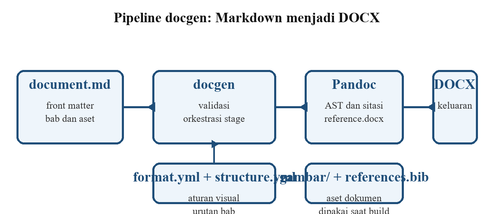

# Pendahuluan

## Latar Belakang

Laporan akademik memerlukan struktur bab, penomoran bertingkat, caption, dan
daftar pustaka yang konsisten. Ketika seluruh pekerjaan dilakukan langsung di
pengolah kata, perubahan satu paragraf dapat menggeser posisi tabel, gambar,
dan nomor halaman. Pemisahan antara isi dan presentasi mengurangi masalah
tersebut karena naskah disimpan sebagai teks yang mudah diperiksa dan
dibandingkan [@gruber2004markdown; @pandoc2024].

Pendekatan berbasis Markdown juga memudahkan peninjauan melalui sistem
kontrol versi. Perubahan naskah tampil sebagai diff baris, bukan sebagai
berkas biner yang tidak terbaca. Pipeline `docgen` memanfaatkan sifat ini
dengan menempatkan aturan visual di berkas format, urutan bab di berkas
struktur, dan isi laporan di `document.md`.

## Rumusan Masalah

1. Bagaimana merancang pipeline yang memisahkan naskah, aturan format, dan
   urutan struktur dokumen akademik?
2. Bagaimana memastikan front matter, aset, dan urutan bab tervalidasi sebelum
   proses build dijalankan?
3. Bagaimana menjaga konsistensi caption, persamaan, penomoran, dan daftar
   isi pada keluaran DOCX?

## Tujuan

Tujuan pembahasan ini adalah menjelaskan rancangan pipeline `docgen`,
menunjukkan mekanisme validasi konfigurasi dan aset, serta mendemonstrasikan
fitur Markdown yang didukung melalui contoh tesis satu berkas.

## Batasan Masalah

Pembahasan dibatasi pada struktur `thesis` dan format `undip-msi`. Keluaran
utama adalah DOCX; PDF dihasilkan dari DOCX melalui Microsoft Word pada
lingkungan Windows. Contoh tidak mengukur waktu kompilasi atau kualitas
tipografi secara kuantitatif.

# Tinjauan Pustaka

## Markdown dan CommonMark

Markdown diperkenalkan sebagai format teks polos yang mudah dibaca dan
ditulis [@gruber2004markdown]. Spesifikasi CommonMark kemudian menetapkan
aturan sintaks yang lebih ketat agar hasil konversi konsisten di berbagai
perangkat [@commonmark2021]. Varian Pandoc Markdown menambahkan dukungan
tabel pipa, persamaan LaTeX, sitasi BibTeX, dan atribut blok yang dipakai
pipeline ini [@pandoc2024].

## Pandoc sebagai Konverter Dokumen

Pandoc membaca Markdown menjadi abstract syntax tree, lalu menuliskannya ke
format tujuan. Filter Lua dapat mengubah AST sebelum writer dijalankan
[@krewinkel2020pandoc]. Pada `docgen`, sebagian besar pascaproses dilakukan
pada DOCX agar aturan Word yang tidak dapat diwakili AST tetap dapat
diterapkan secara eksplisit.

## Office Open XML

Standar Office Open XML menyimpan dokumen Word sebagai paket ZIP yang memuat
`word/document.xml`, `word/styles.xml`, `word/numbering.xml`, dan relasi
antarbagian [@iso2021openxml]. Pipeline memanfaatkan struktur ini untuk
memberi nomor persamaan, mengganti field daftar isi, serta mengatur section
dan penomoran halaman.

: Pemetaan lapisan pipeline docgen

| Lapisan | Berkas | Tanggung jawab |
| --- | --- | --- |
| Format | `format.yml` | Margin, font, caption, CSL, dan aset visual |
| Struktur | `structure.yml` | Urutan bab, front matter, TOC, dan penomoran |
| Konten | `document.md` | Judul, abstrak, bab, tabel, gambar, dan sitasi |
| Pipeline | `src/docgen` | Validasi, orkestrasi stage, dan penulisan DOCX |

# Metodologi

## Arsitektur Pipeline

Pipeline dijalankan sebagai rangkaian stage yang memiliki urutan tetap.
Validasi dilakukan sebelum Pandoc, sedangkan perapian caption, persamaan, dan
penomoran dilakukan setelah DOCX terbentuk. Hubungan antarbagian tersebut
ditunjukkan pada diagram berikut.

```{.mermaid caption="Alur validasi dan build dokumen"}
flowchart LR
  A[document.md] --> B[docgen check]
  B --> C{Valid?}
  C -- Ya --> D[Pandoc]
  C -- Tidak --> E[Perbaiki front matter]
  D --> F[Stage DOCX]
  F --> G[out/document.docx]
```

Stage `validate` memeriksa caption tabel dan alt text gambar. Stage `mermaid`
mengganti blok diagram menjadi PNG sebelum Pandoc membaca Markdown. Setelah
Pandoc menulis DOCX, stage `code`, `captions/figures`, `normalize`,
`equations`, `numbering`, `blank_lines`, `terms`, `toc`, `page_numbers`, dan
`lists` bekerja pada `word/document.xml` serta bagian paket terkait.

## Validasi dan Pemeriksaan Awal

Perintah `docgen check` memuat front matter, mencari berkas format dan
struktur, memvalidasi urutan Heading 1, lalu memeriksa keberadaan gambar dan
bibliografi. Perintah ini tidak memanggil Word sehingga aman dijalankan di
lingkungan integrasi.

```bash
uv run docgen check examples/thesis-single/document.md
uv run docgen build examples/thesis-single/document.md --target docx
```

## Penomoran Persamaan

Persamaan display ditulis dengan LaTeX dan dikonversi Pandoc menjadi OMML.
Stage `equations` memberi nomor `(bab.n)` secara otomatis, sehingga penulis
tidak boleh menulis nomor persamaan secara manual. Rasio paritas keluaran
dapat dinyatakan sebagai berikut.

$$
P = \frac{N_{\text{sama}}}{N_{\text{total}}} \times 100\%
$$

## Pengelolaan Aset

Gambar harus berada di direktori `gambar/` relatif terhadap `document.md`.
Path absolut dan path yang keluar dari direktori dokumen ditolak. Sitasi
memakai kunci BibTeX dari berkas `references.bib`; daftar pustaka dibentuk
oleh `--citeproc`, bukan ditulis manual.

# Hasil dan Pembahasan

## Struktur Keluaran DOCX

Keluaran DOCX memuat naskah, gaya paragraf, penomoran, caption, dan aset
gambar dalam satu paket. Pembagian tanggung jawab antara naskah dan bagian
paket ditunjukkan pada gambar berikut.



## Hasil Pemeriksaan Contoh

Contoh tesis ini memuat lima bab, dua tabel, satu gambar biasa, satu diagram
Mermaid, satu persamaan display, satu blok kode, dan beberapa sitasi. Hasil
pemeriksaan konfigurasi dirangkum pada tabel berikut.

: Aspek yang diverifikasi pada contoh tesis

| Aspek | Mekanisme | Hasil |
| --- | --- | --- |
| Front matter | Kunci dikenal dan field wajib terisi | Lulus |
| Urutan bab | Heading 1 dibandingkan dengan `structure.body` | Lulus |
| Aset gambar | Path relatif dan berkas harus ada | Lulus |
| Bibliografi | Berkas `.bib` harus ada dan berekstensi benar | Lulus |
| Caption | Tabel memiliki caption dan gambar memiliki alt text | Lulus |

## Pembahasan

Pemisahan lapisan membuat perubahan format tidak menyentuh naskah. Urutan
bab hanya didefinisikan sekali di `structure.yml`, sedangkan aturan visual
berada di `format.yml`. Dengan demikian, dokumen contoh dapat dipindahkan ke
struktur lain tanpa menulis ulang isi bab.

Validasi awal juga memberi umpan balik lebih cepat. Kesalahan seperti
Heading 1 yang tidak sesuai urutan, gambar yang hilang, atau kunci front
matter yang sudah dihapus dilaporkan sebelum Pandoc dijalankan. Pendekatan
ini lebih murah daripada memperbaiki DOCX yang sudah terbentuk.

## Keterbatasan

Contoh ini tidak membuktikan paritas visual penuh dengan pedoman kampus.
Pemeriksaan `docgen check` hanya memvalidasi konfigurasi dan aset, bukan
tampilan akhir. PDF juga bergantung pada Microsoft Word yang tersedia di
Windows, sehingga lingkungan tanpa Word hanya dapat menghasilkan DOCX.

# Penutup

## Kesimpulan

Pipeline `docgen` memisahkan naskah Markdown, aturan format, dan urutan
struktur ke dalam tiga lapisan yang berbeda. Validasi awal menangkap
kesalahan konfigurasi sebelum proses konversi, sedangkan stage pascaproses
menangani caption, persamaan, penomoran, dan daftar isi pada DOCX. Contoh
tesis satu berkas menunjukkan bahwa fitur-fitur tersebut dapat ditulis tanpa
menyisipkan field Word manual.

## Saran

Pengembangan berikutnya dapat menambah pemeriksaan paritas visual terhadap
pedoman kampus dan memperluas contoh ke format institusi lain. Dokumentasi
juga perlu menjelaskan secara eksplisit kapan suatu fitur divalidasi oleh
`docgen check` dan kapan fitur tersebut baru diuji saat build DOCX.

# Lampiran

## Berkas Contoh

- `document.md` memuat front matter dan seluruh bab.
- `references.bib` memuat entri BibTeX yang dikutip.
- `gambar/arsitektur-pipeline.png` adalah gambar biasa yang dirujuk bab hasil.
- Direktori `out/` dan `.laporan/` digunakan untuk artefak build dan tidak
  dilacak oleh Git.
