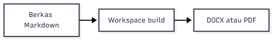

# Pendahuluan

## Latar Belakang

Laporan akademik menuntut struktur, penomoran, dan sitasi yang konsisten.
Penulisan langsung di pengolah kata sering membuat format berpindah saat
dokumen disunting ulang. Pemisahan naskah dan presentasi mengurangi masalah
tersebut karena naskah ditulis dalam Markdown lalu dikonversi oleh Pandoc
[@pandoc2024] menjadi DOCX atau PDF.

## Rumusan Masalah

1. Bagaimana menyusun naskah tesis dalam struktur bab yang baku?
2. Bagaimana memastikan format, metadata, dan sitasi konsisten saat build?

## Tujuan

Tujuan penelitian ini adalah menghasilkan pipeline build yang dapat
menghasilkan DOCX dan PDF dari satu berkas Markdown.

# Tinjauan Pustaka

## Landasan Teori

Pandoc memisahkan penulisan naskah dari presentasi visual [@pandoc2024].
Pendekatan ini memudahkan peninjauan melalui Git karena perubahan teks
tampil sebagai diff baris, bukan berkas biner.

## Penelitian Terdahulu

Penelitian sebelumnya membahas otomatisasi dokumen dan pemisahan konten dari
aturan visual. Pada penelitian ini, pemisahan tersebut diterapkan pada
struktur tesis.

## Kerangka Pemikiran

Kerangka pemikiran penelitian ini menghubungkan naskah Markdown, aturan
format, dan pipeline build.

## Batasan Penelitian

Penelitian dibatasi pada dokumen tesis program magister dan platform
Windows dengan Microsoft Word.

: Perbandingan pendekatan penulisan dokumen

| Pendekatan | Kelebihan | Kekurangan |
| --- | --- | --- |
| Markdown | Diff mudah dibaca | Perlu pipeline build |
| Pengolah kata | WYSIWYG | Format mudah bergeser |

Naskah tetap berupa Markdown, sedangkan aturan visual disimpan di berkas
YAML yang dapat dipakai ulang.

Persamaan berikut menjelaskan hubungan antara jumlah stage dan waktu build:

$$ T = \sum_{i=1}^{n} t_i $$

{width=10cm}

Contoh potongan kode pipeline:

```python
def build(document):
    return Pipeline().run(document, BuildOptions(target="both"))
```

# Metodologi

## Rancangan Penelitian

Penelitian menggunakan rancangan eksperimen pipeline dengan satu sumber
Markdown dan dua target keluaran.

## Tahapan Penelitian

Penelitian dilakukan melalui tahapan identifikasi kebutuhan, perancangan
pipeline, implementasi, dan evaluasi.

### Identifikasi Kebutuhan

Kebutuhan dikumpulkan dari format tesis program studi.

### Perancangan Pipeline

Pipeline dirancang sebagai urutan stage yang idempoten.

### Evaluasi

Evaluasi membandingkan invariant DOCX dan PDF hasil build.

# Hasil dan Pembahasan

## Hasil Build

Pipeline berhasil menghasilkan DOCX dan PDF dari satu berkas Markdown.

: Perbandingan keluaran DOCX dan PDF

| Keluaran | Status | Keterangan |
| --- | --- | --- |
| DOCX | Berhasil | Memuat field TOC native |
| PDF | Berhasil | Diekspor Microsoft Word |

## Pembahasan

Hasil menunjukkan bahwa pemisahan naskah dan presentasi visual menjaga
konsistensi format. Sitasi diproses oleh Pandoc [@pandoc2024].

# Penutup

## Kesimpulan

Pipeline dokumen berbasis Markdown menghasilkan DOCX dan PDF yang konsisten
untuk struktur tesis.

## Saran

Pengembangan berikutnya adalah memperluas pengujian ke platform Linux dengan
keluaran DOCX saja.

# Lampiran

Lampiran berisi contoh konfigurasi build yang dipakai pada penelitian ini.
